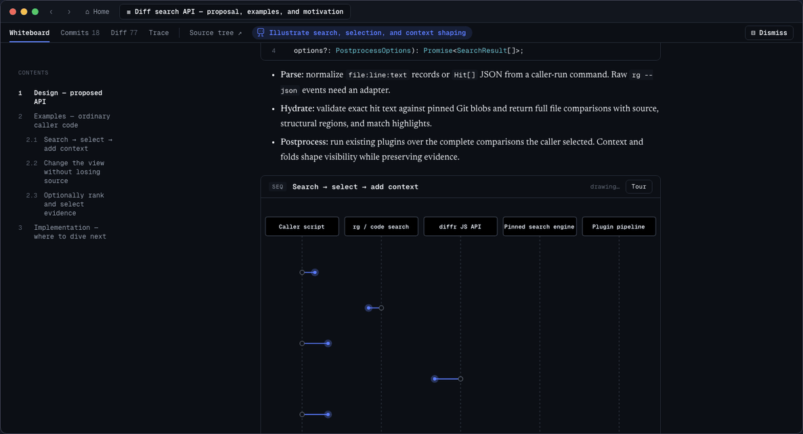

  
  <h1>Blackboard</h1>
  
<strong>an open-source canvas for thoughtful software design</strong>

  

    <a href="https://dev.fast/install">Download for macOS, Windows, and Linux</a> ·
    <a href="https://dev.fast">Website</a> ·
    <a href="https://github.com/devdotfast/whiteboard/wiki/Roadmap">Roadmap</a> ·
    <a href="https://discord.gg/wYvd2cpMQg">Discord</a>
  

Blackboard is an open-source desktop app where humans and agents can architect software together in a common workspace.

Blackboard plugs into the tools you already use - e.g. Claude Code, Codex, etc. – and gives your agent an SDK to draw on an in-app canvas to describe its work.

  

Here’s a 1 min demo video explaining more: https://www.youtube.com/watch?v=ChPn3ftULWE

## Quickstart

1. [Download Blackboard](https://dev.fast/install) and open the app.
2. Connect Claude Code, Codex, or another coding agent from the welcome screen.
3. Ask your agent to review your current branch against up-to-date main and
   open the result in Blackboard.

## Guidance

In our experience, Blackboard works best with models like GPT-6 Sol and Claude Opus 5.5 for their intelligence, cost, and speed tradeoff.

Here are a few example prompts of how to use Blackboard effectively. We are working hard to make sure the right choices are baked in by default to the system prompt - part of why this system is open source! - but in the meantime:

### For a new API change

> hey, this stack of commits is set up so i can get an [api] to do [objective]
>
> i'd like to see:
>
> - proposed api
> - examples
> - motivations for this (if available to you in context/in the repo)
>
> and then we can dive into implementation + explaining how things worked.

### For a change to add telemetry:

> Can you explain to me the telemetry changes form the newest posthog pr https://github.com/devdotfast/whiteboard/commit/4837e107946e27ebad50c282eb0f2585210d2a35 -- what are we tracking, how can we build good dashboards or product waterfalls from it? what do we do for hangs, errors, crashes etc... use blackboard

If you see anything you don't like, highlight it in your clipboard and give it your agent, and it can re-draw on the Blackboard to suit your needs!

## Why does this exist?

### Diagrams that lead to code

Pure HTML tools didn’t provide easy affordances to connect a spec or diagram to code; this is especially tricky since tradeoffs are often only discovered after a first pass at implementation. In Blackboard, when you click on visualizations like a sequence diagram, an entity relationship diagram, or a quote from the agent’s trace, you can jump to the underlying code directly. Pinned code opens in VS Code, where your editor keybindings and language services are available.

### Semantic diff viewer

Raw diff views can be very noisy, so we wrote a semantic, AST-aware diff viewer in Rust so you can only view the code changes which are relevant to you. We’ve set up some sane defaults: large added functions are summarized as pseudocode, and things like unit tests and documentation changes are collapsed / hidden. This is all customizable with a WASM-based plugin system.

### Decision log

We found it difficult to reason about what set of decisions our agents made autonomously & how that impacts a change. So we built tools for agents to query and link their own traces on the Blackboard, so you can visualize the requirements that you set, understand how they were implemented, and understand what decisions the agent made autonomously.

## Open source, on your machine

Blackboard is MIT-licensed and runs against your local checkouts. A hosted
product for teams is planned, and everything will always remain self-hostable.

## Known limitations

- You cannot currently edit files in Blackboard. If this is something that you find yourself wanting to do, please file an issue!

- Working and browsing files across multiple repos in a single review isn't well supported.

- While you can share reviews between machines with the share button, updates made after a review is shared don't appear for others. You would need to re-share the review.

## Contributing

Contributions and feedback are welcome.

Read [CONTRIBUTING.md](CONTRIBUTING.md) for setup and the pull request workflow,
and follow the [Code of Conduct](CODE_OF_CONDUCT.md). Report vulnerabilities as
described in [SECURITY.md](SECURITY.md). Questions? Ask on
[Discord](https://discord.gg/wYvd2cpMQg).

## Privacy

Blackboard runs against local checkouts. Anonymous telemetry does not include
your code, diffs, Blackboard text, prompts, or model output. Read the
[privacy overview](docs/privacy.md), inspect the complete
[telemetry reference](docs/telemetry.md), or turn telemetry off at any time.

## License

Blackboard is available under the [MIT License](LICENSE). Third-party notices
for the shared runtime are in
[`packages/review/THIRD_PARTY_NOTICES.md`](packages/review/THIRD_PARTY_NOTICES.md).

## Desktop runtime

Blackboard uses Electrobun with a native webview and a local Bun backend.
Bun also runs the CLI, package installation, builds, and tests. See
[CONTRIBUTING.md](CONTRIBUTING.md) for setup with Bun 1.4.2 and Hutch.

The former Code OSS fork is available in this repository's Git history. Its
upstream sources are at
[microsoft/vscode](https://github.com/microsoft/vscode/tree/8a7abeba6e03ea3af87bfbce9a1b7e48fed567b8).

## Influences

- <https://www.geoffreylitt.com/2026/07/02/understanding-is-the-new-bottleneck>
  — a great overview of the constraints of modern software engineering.
- <https://maggieappleton.com/2025-08-vibe-legacy-code/> and
  <https://blog.val.town/vibe-code> — do a great job describing how AI-generated
  code fits into the pre-2025 notion of software engineering.
- Karpathy on agents:
  - On LLM agents: <https://x.com/karpathy/status/1979644538185752935>
  - On agents as "junior engineer savants":
    <https://x.com/karpathy/status/1915581920022585597>
